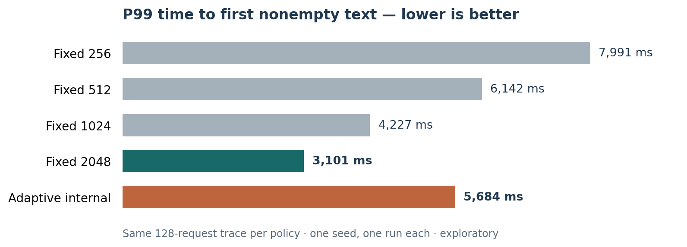
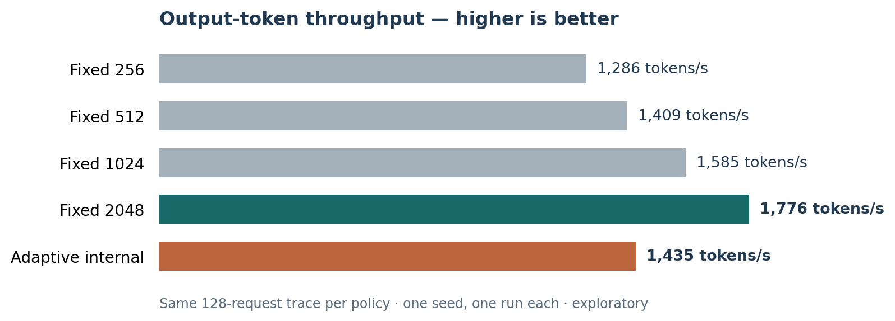

# GPU pilot: the adaptive scheduler ran, but fixed 2048 performed better

**Independent verification report — UC Berkeley EECS PhD research preparation**  
**Run:** 2026-11-06 04:16–04:21 UTC (2026-11-05, Pacific)  
**Status:** Verified exploratory GPU pilot; **not** a published result or admission assessment.  
**Evidence:** User-supplied RunPod execution archive, independently recomputed here.

## Executive summary

Five vLLM scheduling conditions completed on one NVIDIA RTX A6000, running Qwen2.5-1.5B-Instruct (vLLM 0.32.0). Each received the same 128-request bursty mixed-length trace (59 short, 69 long). All **640/640 requests completed successfully**. The trace hash, request IDs, requested lengths, and output-token totals (21,440 per policy) match across the five runs.

The custom `PressureAwareScheduler` launched inside vLLM and its engine allocation logs recorded **512, 1024, and 2048** token budgets during work. All logged per-step allocations stayed within their chosen caps. **Live integration and budget switching are supported by the evidence.**

The adaptive rule did **not** win this pilot: compared with fixed 2048, its client-observed P99 time to first nonempty text was **83.3% higher** (5.684 versus 3.101 seconds) and output throughput was **19.2% lower** (1,435 versus 1,776 output tokens/s). This is a meaningful negative observation, not a proof that adaptive scheduling generally fails.

## Independent GPU measurements

| Policy | P50 TTFT (ms) | P95 TTFT (ms) | P99 TTFT (ms) | Output tokens/s | Long-group P95 TTFT (ms) |
|:---|---:|---:|---:|---:|---:|
| Fixed 256 | 2,515 | 7,315 | 7,991 | 1,286 | 7,305 |
| Fixed 512 | 1,540 | 5,436 | 6,142 | 1,409 | 5,426 |
| Fixed 1024 | 1,161 | 3,667 | 4,227 | 1,585 | 3,661 |
| Fixed 2048 | 868 | 2,430 | 3,101 | 1,776 | 2,428 |
| Adaptive internal | 1,453 | 5,269 | 5,684 | 1,435 | 5,261 |

*Client TTFT = first nonempty streamed text timestamp minus intended client arrival time, including client-side admission and network overhead. Output throughput = total completed output tokens divided by elapsed wall-clock time from the first request arrival to the last completion. The latter is not server-only generation throughput.*

## What the runtime evidence verifies

- **Hardware/software logs:** recorded `NVIDIA RTX A6000`, 49,140 MiB, driver 595.91.07; vLLM 0.32.0; Python 3.12.3; Qwen2.5-1.5B-Instruct (pinned model revision `989aa798...`). The archive contains the `nvidia-smi` probe result, pinned configuration, server logs, live SSE response events, and client timestamps. These artifacts support a real GPU execution account, **not cryptographic hardware attestation**.
- **The intervention:** all conditions fixed `max_num_batched_tokens=2048`, model, GPU, FP16, cache setting, and model length. Fixed 256/512/1024 limited `max_num_scheduled_tokens`; fixed 2048 used the full cap. The custom scheduler temporarily changed the internal **scheduled-token** cap before delegating to the vLLM V1 scheduler. This is not merely an external request-admission policy.
- **Allocation audit:** 758 adaptive scheduling steps (754 nonempty), with 512 at 253 steps, 1024 at 31, and 2048 at 474. No step's logged `actual_tokens` exceeded its selected budget. Four fixed-policy allocation logs contained one corresponding budget each. The logs include server smoke-test activity as well as the benchmark.
- **Independent recomputation:** `independent_recompute.py` read the original 640 request rows and recomputed TTFT percentiles, end-to-end latency, throughput, client TPOT, and cohort metrics with NumPy, independently of the supplied analyzer. The maximum absolute difference across checked reported metrics was **zero**. Streaming SSE events were parsed without errors for all five conditions (128 distinct request IDs per run). The five request-trace hashes matched exactly.
- **Code lineage:** the source ZIP hashes match all recorded experimental source hashes. The one changed launcher script (`scripts/run_matrix.py`) matches exactly after applying the documented `SO_REUSEADDR` port-fix patch. This ties the measured run to a reconstructable code snapshot, but does not make the experiment independently replicated on a second machine.

## Interpretation and research questions

Fixed 2048 dominated the adaptive rule on the measured client P99 TTFT and output throughput in this experimental setting. The adaptive policy also had a **116.6% higher long-request P95 TTFT** than fixed 2048, suggesting that the heuristic did not protect long-request responsiveness in this specific run. Higher tail latency for long requests is **not**, by itself, a complete formal fairness analysis.

A **possible, unproven explanation** is that the policy reduced prefill progress too aggressively when the queue and decode counters indicated pressure. In the observed workload, the cost of smaller scheduled-token caps may have outweighed any decode protection. Alternative explanations include token-budget thresholds, batch-shape changes, startup/runtime noise, and GPU-specific effects. An ablation changing thresholds/hold time with proper repetitions could distinguish these explanations.

The appropriate follow-on research question is **when workload-aware budget reduction improves tail responsiveness relative to the best tuned fixed limit, and when its prefill, overhead, and long-request costs negate the benefit**. A rigorous answer requires additional matched seeds, request volumes, offered rates, burst regimes, output-length mixes, model/GPU configurations, and formal long-request fairness metrics.

## Limitations — important for any Berkeley claim

1. **Only one seed and one run per policy.** Each policy had 128 requests; P99 is determined by very few tail observations. The paired-bootstrap file reports one paired block and therefore does **not** provide a meaningful confidence interval.
2. **Only one model, one RTX A6000, one synthetic bursty mixed-length trace, and one offered rate.** The observed ranking is not generalizable to different hardware, decode-heavy, chat, or long-context traffic.
3. **Client-observed TTFT and token-stream gaps are not pure server timing or token-level ITL.** The provided long-group TTFT is not a direct starvation/queue-waiting measure.
4. **Instrumentation and launch order are potential confounders.** Fixed variants are instrumented too, which helps, but all runs were sequential and not independently replicated. Some server logs report engine exceptions during shutdown after successful completed requests; they should not be silently ignored or misdescribed as request failures.
5. **The custom implementation was AI-assisted.** The experiment supports runtime integration and a baseline comparison, not independent invention, novelty, publication, or verified superiority. Berkeley application claims must reflect the applicant's actual understanding and contributions.

**Source interpretation:** vLLM v0.32.0 documents `max_num_scheduled_tokens` as the per-iteration issue cap, distinct from `max_num_batched_tokens`, supporting the intervention description (https://docs.vllm.ai/en/v0.32.0/configuration/engine_args/). Related proposals include P-PAS (https://arxiv.org/abs/2608.15171) and SLOWeave (https://arxiv.org/abs/2609.07883). This pilot is **not** a head-to-head evaluation against their published implementations.

## Suggested application wording — subject to Philippe's review

**CV candidate:** “Evaluated an AI-assisted experimental in-engine vLLM scheduling prototype on an NVIDIA RTX A6000 using matched synthetic inference traces; verified dynamic per-step token budgets and 640 successful requests across five pilot conditions. Independently recalculated latency/throughput metrics and documented a negative result against the strongest fixed-budget baseline (single-seed exploratory study).”

**SOP candidate:** “In a preliminary GPU study using vLLM, I compared an experimental workload-aware scheduling rule with four fixed-token policies. Although the adaptive controller changed internal budgets during serving, a well-performing fixed configuration achieved better tail latency and throughput in the tested workload. The result challenged my assumption that adaptation would necessarily help and sharpened my interest in identifying the precise operating conditions and fairness tradeoffs under which adaptation is justified.”

Both excerpts are accurate only to the extent the applicant has personally reviewed and can explain the AI-assisted code, the method, and the evidence. Neither asserts novel scientific discovery or research publication. **Do not present this pilot as a peer-reviewed result or as proof of general performance trends.**

## Reproduction and evidence chain

The complete data is retained in `Raw_RunPod_GPU_Evidence.zip`. The matching code snapshot is in `Research_Source_Code.zip` (the source runner has one documented port-check fix). To reproduce the **local arithmetic audit** without a GPU, extract the raw ZIP into this folder, install NumPy if necessary, and execute `python independent_recompute.py`. It writes `independent_results/` with exact summary values and scheduler/event checks.

Primary source files within the raw archive:
- `results/pilot_fixed_20261106_041612/runs/*/requests.csv` and `events.jsonl` — per-request and SSE records.
- `results/pilot_fixed_20261106_041612/server_logs/*/server.log` and `allocations.jsonl` — runtime configuration, logs, and scheduler action.
- `results/pilot_fixed_20261106_041612/environment/environment.json` — GPU/software probe, code SHA256.
- `results/pilot_fixed_20261106_041612_analysis/summary.csv` — original reported metrics.

Evidence archive SHA256: `b74d55753bbd9bf37c20ac2fcb8361e139d22779775ee59a8a47b2c10b165d8c`. Source-code archive SHA256: `d4d778b42f51c9998b7fea511692cf3160211f35d18b3a89fd4acc1cd17c60a1`.

**Readiness:** Suitable as a transparent *preliminary systems experiment* or discussion with Philippe. Not suitable as a claim of general performance improvement, novel published research, or independently replicated benchmark superiority.
